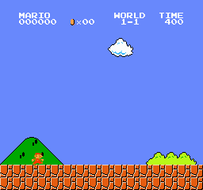
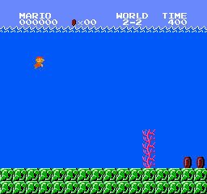

English | [简体中文](README.zh-CN.md)

# Mario RL — one network clearing multiple worlds of *Super Mario Bros.*

Teaching an agent to play NES *Super Mario Bros.* from scratch with reinforcement learning, starting from single-stage PPO and scaling all the way to 32 stages:
one teacher per stage (mazes 7-4 / 8-4 unsolved), distilled into pixel-only student networks (one main network + one 2-2 stage-specific network). Full-game playthrough with three lives averages 8.65 stages; the best run cleared 21 stages (reaching 6-2).
Early on it only covered three worlds, 12 stages in total. Expert training, distillation and single-world students all ran on one Mac (CPU only);
only the final twelve-stage merge hit the memory wall and moved to a GPU machine (see "memory wall" below).
Every experiment, failure and fix along the way is recorded here.

Built on the [`gym-super-mario-bros`](https://github.com/Kautenja/gym-super-mario-bros) emulator
+ PPO from [`stable-baselines3`](https://github.com/DLR-RM/stable-baselines3).

## Results

### 2026-09-23 → 10-14: switching the target from "per-stage average" to "playthrough" (latest)

**The headline metric changed.** The 28-stage single-stage average rose to 90.6% (SWA), yet the playthrough didn't budge (5.6 → 5.7 stages): the single-stage average gives 8-3 and 2-2
the same weight, but 2-2 stops nearly 70% of runs and almost nobody reaches 8-3. From here on the **playthrough** is the primary metric: full game, 3 shared lives,
re-jitter the phase on every new stage (`MARIO_REJITTER=30`), `hybrid` play mode, 192 runs per evaluation, **every model run at least twice and merged**
(the same model can differ by more than 0.5 stages between two runs). Mean and standard error are reconstructed by `playthrough_stats.py` from per-stage clear counts.

**Current best: main network + 2-2 stage-specific network, playthrough average 8.65 ± 0.20 stages** (8.93 / 8.37, two runs of 192 each),
0.76 stages more than the same main network alone (v47 7.89 ± 0.20, about 2.7σ); the best run reached 6-2 (21 stages cleared).
The share of runs that eventually clear 2-2 went 63% → 78%, and lives spent per entry into 2-2 went 1.0 → 0.77. The next biggest life sinks are 2-4, 4-3, 3-3, 1-3.
Upper-bound reference: handing 2-2 directly to the IMPALA teacher gives 9.76 ± 0.22.

| Stage | Approach | Playthrough avg |
|---|---|---|
| Starting point | v32 / SWA | 5.9 |
| Playthrough DAgger | Student plays whole games the way it is deployed, querying the current stage's teacher every frame (`collect_dagger_playthrough.py`), two rounds | **8.07 ± 0.13** (v42) |
| 4-4 | Read the disassembly and wrote a state-based expert `expert_44.py`; the student learns 4-4 (31/31) | 8.02 (v44, flat but can do 4-4) |
| 2-2 teacher swap | See below | 8.10 (v46) / 7.89 (v47) |
| **Main network + 2-2 stage-specific network** | On entering 2-2, switch to a student trained only on 2-2 (`MARIO_STAGE_MODELS` in `run_fullgame.py`) | **8.65 ± 0.20** |

#### The student side has hit its ceiling

- **Soft distillation loss has a hard floor = the mean entropy of the teacher's output distribution.** The floor over all 28 stages is 0.8346; v32 already reached 0.8600, using up
  97.5% of the gap between "constant solution (1.8556) and the floor". A bigger network (BigCNN 9.55M) only shrank the gap from 0.0254 to 0.0227,
  with clear rate flat; sharpened targets and hard labels gave nothing. This floor takes ten seconds to compute — compute it before talking about "more capacity".
- **Large backbones collapse into a constant function** (same distribution for any input; loss exactly equals the entropy of the marginal distribution). Two causes:
  sb3's √2 orthogonal init compounding through 20 residual layers (fixed in `impala_cnn.py` with GroupNorm), and the initialization lottery
  (the same seed knocking out networks of two different sizes). `distill_all12_gpu.py` detects this with that criterion during real training and switches seed automatically.
  Proxy probes (full-batch / small-batch) both missed it at times; the criterion can only live in real training.
- **4-4 is solved**: twelve previous approaches all scored 0/31. Per the disassembly's `ProcLoopCommand`, 4-4 requires `Player_Y==$40` on page 5
  and `==$B0` while standing on the ground on page 9, with the check happening on the frame when the renderer loads column 0 of that page. What was missing was never "the right route"
  but "how the game judges it" — and that can only be read from the disassembly.

#### The root cause is "memorizing timing", not lack of ability

Deterministic emulator + perturbation only at the start of a run → the teacher learns to "memorize a string of precise timings": 98% single-stage yet 25% failure on entering the stage in a playthrough,
collapse when 25% sticky actions are added, and five ways of doing RL after distillation all just reshuffle which phases pass.
**Continuing teacher training in a sticky-action environment** turns it around: 1-3 under sticky actions 33% → 85%, still 121/121 in the clean environment,
and first-attempt failure on entering 1-3 in a playthrough 6.4% → 0%. Continued training stayed smooth all the way, without the cliff seen in earlier continued training.

#### 2-2: taking it apart step by step

Each entry into 2-2 costs about 1 life on average — more than all other stages combined. In chronological order:

1. **The real root cause is the game's random number generator.** The RNG lives in 7 bytes starting at RAM `$07A7` and advances every frame; whether a Cheep-Cheep drifts up or down when it spawns,
   and when a Blooper turns, both read it. In the single-stage environment the RNG is identical every time 2-2 starts, so the teacher only ever saw one set of fish; in a playthrough it depends on
   the total frame count since power-on. **No training, just swapping the RNG** (`diag_22_rng.py`, state pool sampled by idling the emulator) drops the teacher's single-stage rate from 66% to 41-47%,
   landing right on the playthrough entry rate of 43.5%; with the same start timing and a swapped RNG, 47 pass→die and 24 die→pass.
   Sticky actions can't fix this — they perturb Mario's button presses and never touch the fish.
2. **Continued training with a new RNG every episode** (`MARIO_RNG_POOL`): memorizing the fish was cured (original and swapped-RNG scores are equal),
   and first entry into 2-2 in a playthrough went from 41% to 49% (the group with sticky actions, 1453 runs over five batches), but did not reach the preset 55%.
3. **Can't see it? No.** (`diag_22_visible.py`) The fish that kills Mario has been continuously on screen for a median 1.2 seconds before the death,
   minimum 0.87 seconds, almost always entering from the right edge of the screen. The information is in the frame; the agent just hasn't learned to dodge.
4. Savestate search for hard labels (a survival path was found from 92% of death points; it was learned but didn't transfer), and dedicated practice starting from savestates on the fish section: all at 45-52%.
5. **Switching the backbone is the only thing that cleared the bar.** Same per-episode RNG swap + sticky actions, trained **from scratch**: WideNatureCNN couldn't learn in 15M steps
   (single-stage 0-1/121); IMPALA-CNN (16/32/64/64 + GroupNorm) reached **57.8%** first-entry 2-2 in playthroughs after 25M steps (two runs merged).
   ⚠️ The same config with another seed got only 30.5% — this was one lucky seed; you can't claim "switching to IMPALA reliably helps".
6. **The teacher got stronger; the student didn't follow.** Relabeling 2-2 with it and distilling gave v47, playthrough 7.89, not better than v46. Measured separately under the same protocol
   (earlier stages played by the same student, swap players on entering 2-2, 300 runs each):

   | Who plays 2-2 | First-entry 2-2 pass |
   |---|---|
   | IMPALA teacher | 57.8% |
   | Student distilled only on 2-2 data (WideNatureCNN) | 46.9% |
   | Same, but learning only the teacher's argmax (hard labels) | 28.5% |
   | All-stage student v47 | 24-31% |
   | All-stage student, 2-2 frames weighted 3× (v49) | 35.1% |

   The bulk is **multi-stage crowding** (24% → 47%); distillation itself only loses 11 percentage points. Giving 2-2 3× weight inside one network doesn't win it back,
   an IMPALA student is worse (playthrough 5.55, 2-2 down to 6.8%), and hard labels are also worse.
7. **So split into two networks**: the main network plays the other stages; on entering 2-2 it switches to a student trained only on 2-2. Both are WideNatureCNN, both see pixels only,
   and the switch is driven by the stage number shown on screen.

#### The most valuable lessons from this stretch

- **Confirm the cause with training-free diagnostics first, then spend the training budget.** The RNG-swap experiment gave its answer in ten minutes; the seven training methods before it all hit the wrong target.
- **Single-stage checkpoint selection has no predictive power for playthroughs.** A checkpoint at 73/121 single-stage only got 45.9% in playthroughs; the top single-stage checkpoint was worse in playthroughs than the second.
- **A single evaluation lies.** The same teacher measured 63.5% and 51.9% first-entry 2-2 in two runs; the same student scored 8.16 and 7.61 in two playthrough runs.
- **RL from scratch depends strongly on the seed**: same config, two seeds, one 57.8% and one 30.5%.

### After scaling to 32 stages (2026-09-09)

**Teachers**: all 29 non-maze stages have a checkpoint, **27 stages ≥87%, mean 93.2%** (66% when the twelve-stage effort started).
The roster and measured scores are in [`teachers.py`](teachers.py), the single source of truth.

**Students** (one network playing 28 stages, 7 actions):

| Student | Per-stage mean (per-phase argmax) | ≥90% | Perfect |
|---|---|---|---|
| `mario_v29` base distillation | 78.9% | 11/28 | 6/28 |
| `mario_v30` +DAgger×1 | 83.3% | 14/28 | 8/28 |
| **`mario_v31` +DAgger×2** | **86.8%** | **16/28** | **9/28** |
| `mario_v32` +DAgger×3 | 85.9% | 14/28 | 7/28 |

### The playthrough gap: mechanism found and fixed (2026-09-20)

Playthrough at only 5.9 stages versus 86.8% per-stage — this gap had been there since the twelve-stage era. This time a big chunk of it was located and fixed:

**First, one hypothesis refuted**: the phase on entering a stage in a playthrough is determined by the previous stage's time and isn't uniform; the suspicion was that it systematically lands on bad phases.
Adding `MARIO_REJITTER=30` to re-jitter the phase on every new stage, restoring the uniform protocol — the score didn't improve (6.0 → 5.5, within noise). **It's not the phase.**

**The real culprit is the inference mode**. The `hybrid` mode "switches to sampling for the rest of that life after one death", and sampling is much weaker than argmax:

| Mode | 28-stage mean |
|---|---|
| All argmax | 85.9% |
| All sampling | **70.6%** |

Only three stages prefer sampling — 2-3 (+19pp) / 5-1 (+10) / 8-3 (+10); argmax wins on the other 25, most sharply 8-2 by 52pp and 1-3 by 48pp.
⇒ One death drops the whole rest of that life from 86% to 71%.

**But turning this difference into playthrough gains did not produce a statistically solid result.** Re-testing four configurations at N=96:

| Mode | Avg stages cleared | Best |
|---|---|---|
| hybrid | 6.1 | 15 |
| auto (per measured DET table) | 6.0 | 15 |
| Global phase re-jitter | 5.8 | 15 |
| Selective re-jitter (only 2-2/2-3/2-4/3-2) | **6.4** | 15 |

All four sit at 5.8-6.4, within about 1σ of each other. ⚠️ **Retracted**: I previously reported "auto 6.5 vs hybrid 6.0";
that was **N=24 noise** — at N=96 auto is actually slightly lower.
"Average stages cleared" is a heavy-tailed noisy quantity; don't compare it at N=24 — **conditional success rate is the instrument worth reading**.

**What does hold up is per-stage conditional success rate** (with large enough n):
- Phase does matter, but **the direction splits by stage**: global re-jitter lifts 2-2 from 36% (31/86) to 53% (34/64),
  2-3 77→91, 2-4 67→81, but smashes **1-3 from 96/96 down to 74/96**. The two sides cancel in the total,
  so looking only at the aggregate metric misleads you into "phase doesn't matter" — which is exactly how I misread it the first time.
  ⇒ `MARIO_REJITTER_STAGES` now enables it per stage.
- **2-2 is the overwhelming first-order bottleneck**: 86 of 96 runs reached it, only 31 got through, costing 135 lives.
  Fully consistent with the twelve-stage era's "full-clear rate is basically decided by 2-2".

The best run cleared **1-1 → 4-3, 15 stages**, stopping at 4-4 — **the theoretical ceiling while 4-4 is unsolved** (all four configurations reached it).

### Targeted remedial training on 2-2: single-stage up, net negative overall (v33, not adopted)

`diag_agreement22` (the teacher's argmax drives, argmax compared frame by frame) pinned down the teacher–student gap precisely:
disagreement is **concentrated in x1600-2800** (disagreement rate 25-40%, KL 0.29-0.53; versus only 8-16% and KL<0.07 in x0-1400),
and the student's own death points when it drives are in the same range (15/24, median 2499). By that script's criterion: concentrated = a precision problem,
and the prescription is denser demonstrations on that section. ⇒ Took only the 240k frames with x≥1600, added them to the dataset and re-distilled.

**The prescription worked, but the cost was bigger**:

| | v32 | v33 |
|---|---|---|
| 2-2 single-stage | 58.1% | **64.5%** |
| Per-stage mean | **85.9%** | 84.6% |
| ≥90% | **14** | 13 |
| Playthrough avg | **6.4** | 5.6 |

Up: 2-2 +6.5, 2-4 +6.5, 6-1 +22.6. Down: 4-2 −23, 5-3 −19, 5-2 −13, 5-1 −13.
⇒ Once again "variance between recipes is far larger than per-stage variance". This is the same phenomenon as the first DAgger round breaking 3-3,
but this time **automatic mixing ratios can't save it** — the targeted data is outside what `weights()` adjusts.
**v33 is not adopted; v32 remains the best model.**

**Per-stage and playthrough are two different metrics, and the third DAgger round demonstrates this clearly** (both hybrid / N=24):

| | Per-stage mean | ≥90% | Playthrough avg | Playthrough best | Playthrough worst |
|---|---|---|---|---|---|
| v31 | **86.8%** | **16/28** | 4.7 | **12** | 2 |
| v32 | 85.9% | 14/28 | **5.9** | 9 | **5** |

v32 is flat-to-slightly-down per-stage, while the playthrough **mean and floor both clearly improve** (worst run up from 2 stages to 5).
⇒ For "stable playthroughs" use v32; for "per-stage peak" use v31.
Under the same protocol, the old twelve-stage student v7 gets only 2.0 stages.
> ⚠️ Don't compare against v7's "average 6.6 stages" — that came from running it in `auto` mode (with a hand-tuned per-stage DET/STO table),
> which is not the same protocol as hybrid here. I almost reported a fake "playthrough regression" based on it;
> only a same-protocol rerun showed the direction was the opposite. **Numbers from memory can't be compared directly once the config changes.**

The real playthrough bottleneck is in **the first four stages**, and it is badly disconnected from per-stage scores: 1-3 playthrough 79% (per-stage 97%) ·
1-4 63% (97%) · 2-4 57% (100%). After 3-1 the sample size collapses to single digits; don't read those numbers.

**Unsolved**: the three maze castles 4-4/7-4/8-4 (twelve approaches tried on 4-4, all 0/31; case closed).
> The correct route can be looked up (4-4 = up → down), so what's missing isn't the answer. The key negative result is that **position at the gate is not the criterion**:
> in a height sweep, all nine settings y=40..232 inside the gate window loop back; after feeding waypoints along the correct route, the model did learn to push y from 191-229
> down to 127, and it still looped back. The criterion is **which path was taken earlier** (path state), and I encoded the correct answer "which path to take"
> as a position condition "where you stand at the end" — **looking it up solved the candidates, not the modeling**.

Also still unsolved:
the two water stages 2-2 84% / 7-2 23% (underwater is a systematic weak spot; the only untried option, skip=2, would break "one network plays every stage").

### Early: the twelve-stage phase


| World | Avg clear rate | Recording |
|---|---|---|
| World 1 (1-1 ~ 1-4) | 52% | `mario_world1.gif` |
| World 2 (2-1 ~ 2-4) | 59% | `mario_world2.gif` |
| World 3 (3-1 ~ 3-4) | 60% | `mario_world3.gif` |
| World 1+2 eight-stage merge (single network) | 63% | `mario_all8.gif` |
| **World 1+2+3 twelve-stage merge (single network)** | **73%** | `mario_all12.gif` |

Twelve stages, per stage (100 randomly sampled runs each): 1-1 60% / 1-2 86% / 1-3 95% / 1-4 57% /
2-1 76% / 2-2 70% / 2-3 76% / 2-4 71% / 3-1 73% / 3-2 79% / 3-3 78% / 3-4 54% —
not a single stage at zero; even the worst, 3-4, is at 54%.

> ⚠️ **The protocol behind the table above has a systematic optimistic bias, discovered only later.** Each of these evaluations started from the same "game just booted" state,
> so enemy and moving-platform phases were identical every time, and a policy could score by memorizing a fixed action sequence. After adding Atari's standard
> **no-op starts** (0-30 random no-op frames at the start, changing only the phase), the same models' twelve-stage average went **73% → 53%**,
> with 2-2 falling from 70% to 4%. See "[The evaluation-protocol lesson](#the-evaluation-protocol-lesson-no-op-starts)" below —
> the most valuable part of this project, and the only time I found that "every previous number needs a discount".

One network clearing twelve stages in a row:



The toughest one, underwater stage 2-2 (one-tile-wide gaps between fish + Cheep-Cheeps swimming back and forth):



## Methodology: why not "one PPO brute-forcing every stage"

Training PPO directly on a mix of stages turns into **whack-a-mole** — learn one stage, forget another (catastrophic forgetting + task interference).
What actually worked is an "expert → distillation → merge" pipeline:

1. **Single-stage experts**: train an expert per hard stage with PPO (small NatureCNN), pushing to 80-90%.
   Easy stages are knocked out in one go with mixed training (`SuperMarioBrosRandomStages` random sampling); only the holdouts get their own expert.
2. **Collect teacher data**: let each expert play (random sampling) and record `(frame → the teacher's 7 action probabilities)`.
3. **Soft policy distillation**: one student network imitates every teacher's action distribution with supervised learning
   (soft policy distillation, KL soft cross-entropy `-Σ p_teacher · log q_student`). Pure supervision, fast and stable.
4. **DAgger for drift**: the student drives, the teacher labels the states where it goes off track, those are added to the data and re-distilled —
   curing distillation's distribution shift (once the student strays from the teacher's demonstrated successful trajectories, it's lost).
5. **WideCNN for capacity**: with more stages, the small network can't hold them all (the hardest reactive water stage gets squeezed out first),
   so a widened CNN takes over in supervised distillation.
6. **Cross-world merge**: combine the distillation data of multiple worlds and distill a single network.

Key insight: **distillation/DAgger is supervised learning, minutes and stable; expensive RL is paid only once, when training the experts.**

## Pitfalls flattened along the way (field notes)

- **Sparse reward → ladder shaping**: 2-2's only real signal is touching the flagpole (x≈3161); everything in between is "you did it right but nobody tells you".
  The bare expert fumbled in the dark, stuck at 5%. Placing a row of one-time checkpoint rewards before the hard points (splitting the distant big reward into dense near-term waypoints)
  took the clear rate 5% → 70%.
- **det vs stochastic evaluation**: don't evaluate an unconverged policy with `deterministic=True` — argmax gets stuck in front of some
  probabilistic obstacle and dies repeatedly, badly underestimating real ability. Look at random sampling.
- **Capacity vs task interference**: the more stages, the tighter the capacity, and the most unusual stages (water/maze) always lose health first.
  Generic stages are highly redundant with each other (all "run right + jump when needed") and actually transfer positively (1-3 was stronger in the eight-stage mix than trained alone).
- **Custom CNN double /255 normalization bug**: a features extractor with its own normalization + sb3's default `normalize_images=True`
  → input divided twice to ~[0,0.004] → activations collapse, loss stuck. Fix: `policy_kwargs=dict(normalize_images=False)`.
- **numpy must be <2**: nes-py / gym are incompatible with numpy 2.x (`OverflowError`). Installing torch/sb3 will upgrade it back; remember to pin it down again.
- **Memory wall → switch to VRAM**: when stuffing multiple worlds into one network, distillation data grows linearly with stage count (12 stages, 875k frames of obs ≈ 25GB);
  a 36GB machine can't hold it → memory compression slows random access 25× (~29min/epoch), and disk memmap doesn't help either
  (25GB far exceeds page cache, every epoch is all misses, going from memory-bound to disk-bound).
  Moving to a card with 96GB VRAM, **the whole obs array lives in VRAM**, each batch is a single in-VRAM gather,
  zero host→device copies → **9.3s/epoch (94k frames/s), about 180× faster**, 60 epochs done in ten minutes.
  Distillation is inherently "data read-only throughout, random batches" — the workload best suited to putting it all in VRAM, rather than trying to save memory on the host.
- **Models don't cross numpy major versions**: the zip sb3 saves pickles numpy's internal layout; a model saved under numpy 2.x
  fails to load in numpy 1.x with `ModuleNotFoundError: numpy._core.numeric`. And the emulator chain is pinned by nes-py to
  numpy<2 → distillation must also be done in a numpy<2 environment; don't borrow a numpy 2 environment to train faster (you'll find evaluation can't load it afterward).
  Nastier still, in multiprocess evaluation this error shows up as **all workers silently vanishing and the main process waiting forever** — `mp.Pool` can't detect
  a worker that was hard-killed; switching to `ProcessPoolExecutor` (which raises `BrokenProcessPool`) makes it visible.
- **How much a bug is worth depends on the setting you measure it in**: the same double-normalization bug cost 9.3pp in the original eight-stage recipe,
  but only 2.9pp in the twelve-stage recipe with more data and longer training (the network can partly compensate for input squeezed to ~[0,0.004]).
  The first time I measured it in the latter and concluded "this bug isn't the main cause" — I read it backwards. See "Ablation" below.

## Ablation: why the twelve-stage merge (74%) beats the eight-stage merge (63%)

Three variables: fix the double-normalization bug or not / 30 vs 60 epochs / feed eight-stage (730k) or twelve-stage (875k) data.
Change one at a time, 100 random-sampling runs per stage ("eight-stage avg" = merged clear rate over those 800 runs, ±1SE≈1.7pp).
One epoch is 9 seconds; six training runs + 7200 evaluation runs finish within an hour — **too cheap to justify guessing**.

| Experiment | Data | Epochs | Input | Eight-stage avg | Twelve-stage avg |
|---|---|---|---|---|---|
| ① Original eight-stage merge recipe | 730k | 30 | Double /255 | **62.7%** | 41.8% |
| ② | 875k | 60 | Double /255 | 71.0% | 69.5% |
| ③ Twelve-stage merge result | 875k | 60 | Normal | **73.9%** | **72.9%** |
| ④ | 875k | 30 | Normal | 72.0% | 71.4% |
| ⑤ | 730k | 60 | Normal | 71.4% | 47.6% |
| ⑥ = ① with only the bug fixed | 730k | 30 | Normal | **72.0%** | 48.0% |

- **Fixing the bug: +9.3pp** (①→⑥, same data same epochs, >3σ). The main cause of the low eight-stage merge score.
- **Epochs 30→60: ≈0** (⑥→⑤ −0.6pp, ④→③ +1.9pp, both within noise). The 6.86M-parameter WideCNN has already converged at
  30 epochs; "bigger networks need more training" doesn't hold here.
- **Adding World 3 data: 0 ~ +2.5pp** (⑤→③ +2.5 at 60ep, ⑥→④ 0.0 at 30ep). Basically neutral for the old eight stages,
  but **the four new stages come for free** (③'s W3: 73/79/78/54).
- So "more stages, tighter capacity" doesn't hold: twelve-stage training doesn't lose to eight-stage on the old eight, and gets four stages for free.
  Water stage 2-2 went 38% (①) → 57% (⑥) → 70% (③); it was "squeezed out" back then mainly because of crippled input, not capacity.
- **30 runs per stage aren't enough to resolve these few pp**: at N=30 a single stage can jump between 57% and 83% (crossing 2σ);
  use it to pick a direction first, and raise the sample size to 100 before drawing conclusions.

## The evaluation-protocol lesson: no-op starts

After the twelve-stage merge, I measured something I hadn't before: **put this network into the full game, start from 1-1 and keep going —
how many stages can it clear in a row?** Per-stage it was 73%; intuitively it should clear seven or eight in a row.

Measured: **2.3 stages on average** (32 runs, best 6 stages).

### 73% per-stage, 2.3 stages in a playthrough — where's the gap

First, split by stage and look at "the probability of clearing a stage once you've entered it" (64 playthrough runs):

| | 1-1 | 1-2 | 1-3 | 1-4 | 2-1 | 2-2 |
|---|---|---|---|---|---|---|
| Per-stage, from the start | 60% | 86% | 95% | 57% | 76% | 70% |
| In a playthrough | 81% | 88% | **57%** | 88% | 70% | **25%** |

The two that drop are 1-3 and 2-2 — **one has floating moving platforms, the other Cheep-Cheeps swimming back and forth; what they share is "the obstacles move"**.
The other stages, mostly static terrain, actually went up rather than down. And deaths in 2-2 during playthroughs happen at x=1235~1544,
much earlier than its historical hard point at x≈2095: it isn't failing the one-tile-wide gap between fish; it gets hit by a fish midway.

### Single-variable experiment: change only the enemy phase

Press no-op for a few random frames at the start (no-op starts) and change nothing else — terrain, Mario's form, timer, model all identical,
only the enemy and platform phases are shifted:

| 2-2 clear rate | 0 frames | 2 frames | 4 frames | 8 frames | 16 frames | 30 frames |
|---|---|---|---|---|---|---|
| Ladder expert | 66% | 36% | 26% | 18% | 6% | 4% |
| Twelve-stage student | 80% | 24% | 12% | 10% | 6% | 4% |

**Jitter by 2 frames — 1/30 of a second — and the clear rate is cut in half.** This isn't insufficient robustness; the whole action sequence is locked frame by frame to the fish positions.

Re-testing all models under the Atari standard protocol (0-30 frames):

| | No jitter | no-op 0-30 |
|---|---|---|
| Twelve-stage student | 70.2% | **52.8%** |
| Per-stage teachers (on their own stage) | 74.3% | **56.0%** |

**It's the teachers themselves that memorize trajectories; distillation didn't introduce it.** So it can't be fixed at the distillation stage — the RL training itself must include no-op starts.
(Note 2-3 / 2-4 / 3-2 / 3-3 barely drop or even rise slightly: those teachers really can play. It isn't a collapse across the board;
it's the stages "with moving threats whose timing can be locked in" that collapse.)

This is why Atari benchmarks use no-op starts, and this pipeline lacked that piece from start to finish.

### Reinterpreting two old conclusions

- **"Ladder shaping on 2-2 took the clear rate from 5% to 70%"**: what shaping mainly taught it was "dance this routine all the way through",
  not "dodge when you see a fish". The same model with jitter gets only 4%.
- **"LSTM can't fix reactive dodging in 2-2"**: that environment never required reaction — a feed-forward network can score by memorizing,
  so memory gives no visible advantage. The experiment only means something if redone in a jittered environment.

### Retraining 2-2 with jitter

Warm-start from the ladder expert and train with no-op starts (the best recipe is **curriculum-style escalation**: jitter 0-4 → 0-8 → 0-16 → 0-30,
warm-starting each level, 2M steps per level):

| 2-2 @ no-op 0-30 (N=400) | argmax | Random sampling |
|---|---|---|
| Ladder expert (original) | 3% | 7% |
| Direct training 8M | 3% | 20% |
| **Curriculum 8M** | **35%** | 22% |

Two observations:

- **After training, Δ(jitter − no jitter) ≈ 0** (direct 8M is 25%/25%) — the policy became genuinely phase-independent:
  no longer profiting from phase, no longer afraid of phase changes. Its absolute level is just a third of that old "78%". That's the real number.
- **Curriculum and direct training learned policies of opposite character**: the directly trained one survives on randomness (argmax only 3%);
  the curriculum one is sharp (argmax 35%, 100% without jitter). Graded escalation forced out a deterministic response; going all the way at once only forced out hedging.

Likewise retraining teachers under jitter, World 1 mixed training for 5M steps: average 40.5% → 52.8%, **1-3 from 0% to 59%**.
This path works; the cost is that 1-2 dropped (the old whack-a-mole problem).

### Wrap-up: rerunning the whole pipeline under the honest protocol

Redoing the entire pipeline based on the findings above: **pick, per stage, the teacher measured strongest under jitter** (jitter retraining isn't a clean sweep —
W3 wins big, 3-4 44%→78% / 3-1 3%→64%; W1 half wins, 1-3 0%→59% but 1-2 49%→17%; W2 actually got worse;
so it has to be picked stage by stage) → re-collect 840k frames with jittered starts → re-distill the student → evaluate under three protocols.

| | Old protocol (inflated) | Honest protocol |
|---|---|---|
| Twelve-stage student per-stage (starting point) | 73% | 52.8% |
| Re-distilled from the strongest teacher roster | — | **58.7%** (random sampling) |
| Inference mode picked per stage | — | **73.3%** |
| Full-game playthrough | 2.3 stages | 2.5 stages |

Three takeaways:

**① The teacher→student transfer gap is about 6pp.** Teacher roster average 56% → 64.7%, student 53.8% → 58.7%.
The student sits stably a fixed gap below the teacher — **the only way to lift the student is to lift the teacher first**; more data, more epochs, a different network can't get around this.

**② Which of argmax and sampling is better splits by stage**, and splits extremely (`mario_honest12` @ no-op 0-30):

| | 1-1 | 1-2 | 1-3 | 1-4 | 2-1 | 2-2 | 2-3 | 2-4 | 3-1 | 3-2 | 3-3 | 3-4 |
|---|---|---|---|---|---|---|---|---|---|---|---|---|
| Sampling | 60% | 55% | 62% | 55% | 45% | 10% | 77% | 61% | 51% | 74% | 86% | 68% |
| argmax | 29% | 9% | 24% | **100%** | 56% | 13% | 13% | **100%** | 81% | 83% | **100%** | 93% |

1-4 is argmax 100% / sampling 55%; 1-2 is the reverse, argmax 9% / sampling 55%. **Picking the mode per stage** (the `auto` mode of `run_fullgame.py`)
pushes the honest per-stage average to 73.3% — the same as the inflated 73% at the top, but this time it holds up.

**③ The bottleneck converges to a single point: 2-2.** After picking modes per stage, the conditional success rates of the first five stages in a playthrough are
1-1 71% / 1-2 79% / 1-3 74% / 1-4 95% / 2-1 84%, and then **2-2 is only 12%** — 16 of 48 runs reached 2-2,
and only 2 got past it. Picking modes per stage can't save it, because it's a mandatory single-point gate.

And whether 2-2 can be conquered depends on something already measured clearly: **that argmax-36% model was a lucky hit, not a product of the recipe**.
Running the same recipe (curriculum 0-4→8→16→30, 2M each) with three seeds gives argmax 7% / 12% / 15%,
**zero reproductions** (v1 itself re-tested twice at 35% and 36%, very stable). So planning should use the recipe's reliable output:
**sampling 16-22% / argmax 7-15%**; that 36% is a usable but non-reproducible model on disk.

### The sharp solution looks like a fragile attractor — but that's the entropy bonus's doing

Six methods were tried to improve 2-2, and **the failure mode was identical every time**: the stochastic policy holds steady at 22-25%, while that precious
argmax sharp solution shatters at the slightest touch.

| 2-2 @ no-op 0-30 (N=400) | argmax | Sampling |
|---|---|---|
| `mario_22cur_30` (sharp solution hit by curriculum) | **38%** | 24% |
| Curriculum v2 (with VecNormalize + 12M) | 16% / 2% | 22% / 27% |
| Three seeds (same recipe, different random seed) | 7% / 12% / 15% | 22% / 16% / 17% |
| Second sharp solution `seed6` | 25% | 17% |
| 2-2 targeted distillation (teacher argmax drives to collect data) | 0% | 1% |
| Backplay (start from savestates, P=0.5 / 0.75) | 8% / 15% | 25% / 18% |

The conclusion at the time was "the sharp solution is like a very narrow basin of attraction in the optimization landscape: you can stumble into it but can't stay, it appears with probability ~1/5, down to luck rather than recipe".

**That conclusion was wrong**; the next section is its correction. The real culprit isn't the landscape — it's a hyperparameter I'd left on the whole time.

### The real culprit is the entropy bonus: 2-2 from 3% to 88%

Looking again at the six failed rows of the previous section, what they share isn't the data, the curriculum, or the start distribution — it's that **all of them had
`ent_coef=0.02` on**. This entropy bonus adds a gradient to the loss that "flattens the action distribution as much as possible" — and 2-2 needs exactly the opposite:
pressing the actions into one deterministic line in front of the fish gap. **Every subsequent round of training kept dissolving any policy that got sharp**,
so whatever I changed, it got pushed back to that flat 20-25% hedging policy. It wasn't a narrow basin; there was a hand constantly pushing outward.

The surgery is simple, four things done together:

| Change | Why |
|---|---|
| `ent_coef` 0.02 → **0** | Remove the hand |
| `lr` → **1e-5** | The neighborhood of the sharp solution is small; big steps walk right out of it |
| Save a checkpoint every **250k steps** | Good states are passed through; sparse saving misses them |
| **Pick checkpoints by measured DET**, not `ep_rew_mean` | The latter includes ladder-shaping reward and is decoupled from the real clear rate |

2-2 along this path: 3% → 34% → 71% → **88%** (N=400, argmax, no-op 0-30).
That "non-reproducible 38%" is now a recipe-produced 88%.

**This lesson is worth more than 2-2 itself**: the entropy bonus was the antidote to this project's earliest training collapse (run1), and the poison for the late-stage precision stages.
It shouldn't be constant throughout; it should be annealed with training phase — early on it's needed to sustain exploration, later it needs to step aside.

**Pushing the same surgery to the other eleven stages: ten up, two down** (N=150 @ no-op 0-30, best checkpoint + best inference mode per stage):

| | 1-1 | 1-2 | 1-3 | 1-4 | 2-1 | 2-2 | 2-3 | 2-4 | 3-1 | 3-2 | 3-3 | 3-4 | Average |
|---|---|---|---|---|---|---|---|---|---|---|---|---|---|
| Before surgery | 68 | 45 | 39 | 82 | 46 | 34 | 84 | 69 | 64 | 85 | 98 | 79 | 66.1 |
| After surgery | **93** | 9 ✗ | **100** | **94** | **100** | **88** | 83 ✗ | **98** | **100** | **89** | **100** | **96** | **90.6** |

The interpretation at the time was "zero entropy only helps stages that need precision and decisiveness, and hurts lenient stages like 1-2 and 2-3".
The 2-3 half was right (retrained, best 87% vs 83% starting point, within noise — it really is at its ceiling);
**the 1-2 half was wrong; see the next section**.

Two protocol notes in passing:

- **DET / STO must be picked per stage**. With the same weights, 1-3 is 100% with argmax and 1-1 is 93% with sampling.
  A one-size-fits-all evaluation protocol underestimates half the stages.
- **But always collect distillation data with sampling**, even when the teacher's argmax score is higher (see the item in "tried and didn't help" in the next section).
  Fortunately the distribution trained with zero entropy is itself close to one-hot, so sampling ≈ argmax, with coverage coming from the residual entropy.

### Checkpoint density is itself a hyperparameter: 1-2 from 45% to 88%

The previous section judged 1-2 as "surgery harmful, 45% → 9%". That 9% came from the 3.5M and 6.25M checkpoints of the World 1 mixed-training arm,
and that arm's **earliest checkpoint was at 750k**. Retraining 1-2 alone with a checkpoint every 25k steps, the truth is:

```
start 55% → 24k 58% → 99k 85% → 149k 89% → …81-91% all along… → 399k 91% → (only starts to burn after this)
```

Not a spike, but a wide plateau from 100k to 400k steps. An N=400 re-check gives **88%**, and `noop=0` vs `noop=30`
differ by only 1pp — **a genuinely phase-independent policy** (the original teacher went 83% → 56%; those 27pp were all inflation from memorizing phase).

⇒ **Of the surgery's three pieces, "dense checkpoints + pick by measurement" is the lead**; zeroing entropy and small lr just raise the peak.
The control arm (keeping `ent_coef=0.02`, changing only lr and checkpoint density) got only 41% at the same point, so entropy does contribute too,
but without the former you'd see nothing. And I had used 750k as the earliest checkpoint for **every stage** — systematically skipping
the stretch most likely to produce results (2-4's best checkpoint happened to be exactly the earliest, 750k, a boundary value that most likely missed the real peak too).

At this point the twelve-stage teacher roster: 1-1 93 / 1-2 88 / 1-3 100 / 1-4 94 / 2-1 100 / 2-2 88 /
2-3 84 / 2-4 98 / 3-1 100 / 3-2 89 / 3-3 100 / 3-4 96, **average 66.1% → 94.2%**.

The same fine sweep was pushed to two other **boundary checkpoints** (their best checkpoint happened to be the first or last of that arm,
a classic "peak outside the window" signal): 2-4's 750k was the earliest → the fine sweep found **100%** across the whole 74k-224k step range;
3-2's 6.25M was the last → continued single-stage training, **100%** from 49k steps all the way to 600k without dropping.
⇒ Neither boundary checkpoint was the peak; the teacher mean rose further to 95.4%.
(But these two stronger teachers **did not make the student better** — it got worse; see v8 in the next section.)

### Student: v5 → v6, full-clear rate 17%

| | Teacher mean | Student per-stage best | Playthrough avg | Twelve-stage full clear |
|---|---|---|---|---|
| Starting point | 66% | 61% | 2.3 stages | ~0 |
| v5 (re-distilled with new roster) | 94% | 84.2% | 5.2 stages | 2% |
| v6 (+ targeted DAgger) | 94% | 89.7% | 5.5 stages | 17% |
| **v7 (+ second DAgger round)** | 94% | **91.9%** | **7.1 stages** | **20.8%** (20 of 96 runs reached 4-1) |
| v8 (+ stronger 2-4/3-2 teachers) | 95% | — | 5.2 stages | 11.5% ✗ |

**v8 is a negative result, and worth recording.** The fine sweep raised the 2-4 teacher from 98% to 100% and 3-2 from 89% to 100%;
only those two stages' data were re-collected and re-distilled — and the student dropped on **stages that weren't touched**: 2-1 99% → 74%, 2-2 59% → 41%,
playthrough 7.1 → 5.2 stages. ⇒ **A stronger teacher doesn't mean a better student**. Those two new teachers were trained to 100% with `ent=0`; the policies are extremely sharp,
the sampled trajectories form a narrow pipe, and state coverage actually gets worse. This is the same mechanism as "argmax drives to collect data, 11% → 0%",
just disguised this time as "I switched to a better teacher". **Distillation data needs coverage, while the metric teachers are scored on is clear rate,
and these two things can diverge.**

Per-stage conditional success rates in v7 playthroughs (N=96): 1-1 95 / 1-2 97 / 1-3 100 / 1-4 100 / 2-1 99 / **2-2 59** /
2-3 84 / 2-4 79 / 3-1 100 / 3-2 94 / 3-3 81 / 3-4 77. The first five stages basically no longer drop.

Per-stage conditional success rates in playthroughs: 1-1 94 / 1-2 93 / 1-3 93 / 1-4 98 / 2-1 82 / **2-2 45** /
2-3 74 / 2-4 86 / 3-1 100 / 3-2 100 / 3-3 92 / 3-4 100.
The product is 17.2%, matching the measured 11/64 — **this chain is now predictable**; you can directly compute what to fix next
(2-2 from 45% to 90% would take the full-clear rate from 17% to about 34%).

Three changes made it move, and each one overturned an earlier conclusion of mine:

**① The 2-2 teacher–student gap is error accumulation, not capacity.** Teacher 89%, v5 student 45%, 41pp — while other stages differ by only 6pp.
The decisive experiment: distilling a **same-architecture** student on 2-2 data alone also gets only 50% (mixed 45%, only 5pp apart).
So it wasn't squeezed out by the other eleven stages; behavior cloning simply can't copy this stage faithfully: the champ is a precise low-entropy trajectory,
and 99% per-frame accuracy spread over a 2000-step run leaves nothing. **Targeted DAgger is worth +21pp (48% → 69%)** —
the previous twelve-stage DAgger round was worth only +2pp, because back then the ceiling was the teacher; now the weak spot has become "the student can't copy faithfully".

**② ~~Flushing the frame buffer across stages is worth +0.9 stages~~ — this was later overturned by a larger sample; see the end of the document.**
At the time (N=64), `MARIO_FLUSH=1` measured as lifting playthroughs from 4.3 to 5.2 stages and 2-2 playthrough success 15% → 37%,
and from that I wrote "how much a change is worth depends on where the bottleneck is when you measure it". That methodology isn't wrong (double /255 is an instance of it),
**but this switch was the wrong example**: raising the sample to N=288, flush / no flush / warm-up all tie exactly.

**③ The `DET_STAGES` table in `run_fullgame.py` belongs to the model.** On v5, 1-3 flipped to DET 99% / STO 49%;
playing with v4's old table throws away 50pp — the first time I measured "playthrough only 2.5 stages" it was this bug, and I nearly took it as a real regression.
It's now overridable via the `MARIO_DET_STAGES` env var, and the comment states flatly "must be refilled when the model changes".

### The last 30pp of 2-2: located correctly, fixed single-stage, but didn't carry over to playthroughs

Teacher 86%, v7 student 56%, still 30pp short. First question: "can giving 2-2 its own parameters fix it" —
**distilling a dedicated same-architecture student on all current 2-2 data (including two DAgger rounds) gets only 64%** (mixed student 56%).
⇒ **Devoting the entire 6.86M-parameter network 100% to 2-2 buys only 8pp**; the remaining 22pp has nothing to do with "enough parameters,
MoE / expert heads or not". (So the ceiling of MoE on this problem is those 8pp — not worth writing gating for.)

What are those 22pp? `diag_agreement22.py`: let the **teacher**'s argmax drive and compare both choices frame by frame:

```
x    0-1400   argmax disagreement  5-6%    KL 0.01     ← first half nearly identical frame by frame
x 1400-2000                 14-20%  KL 0.18
x 2200-2800                 29-30%  KL 0.38-0.47 ← peak
x 3000-3200                  0.4%   KL 0.01     ← straight road before the flagpole
```

The median death point when the student drives is x=2214, matching the disagreement peak. **It's a local precision problem, not a representation problem** —
2-2 is 3161 pixels long, and the truly hard 800 pixels get less than a quarter of uniformly sampled data.
Accordingly piling 160k frames of DAgger labels onto x≥1300: **2-2 single-stage 56% → 74%** (N=300), gap narrowed to 13pp.

⚠️**Halfway through I hit a more fundamental bug, worth recording separately.** I originally wanted to use savestate starts (`ArchiveStart`) to skip the first half;
after collecting, I found the student starting from x=1408 cleared only 13% and each run lasted only 75 frames — closer to the goal yet worse.
Only a control made it clear: **putting the teacher at the same savestates, it drops from 86% to argmax 21% and dies in 32 frames.**
The cause: on reset `FrameStack` was filled with "the same frame copied four times", **so all velocity information in the observation was gone** —
2-2 is an underwater stage; the policy relies on 4-frame differences to judge where and how fast fish are swimming, and seeing a bunch of "stationary fish" it swims right into them.
Those 160k frames were discarded and re-collected (playing normally from the start, recording only frames with x≥1300, so the distribution is naturally correct).
The earlier note "savestate mechanism works (start at x≈1880)" only verified the **position** was right, not that the **state** was usable — two different things.

**But the 18pp single-stage gain didn't carry over to playthroughs** (N=96 grid):

| Playthrough avg stages / full-clear rate / 2-2 conditional success | v7 | v9 (+ targeted DAgger) |
|---|---|---|
| With `MARIO_FLUSH=1` | **7.1 / 20.8% / 59%** | 6.0 / 12.5% / 41% |
| Without | 5.9 / 13.5% / 44% | 6.7 / 17.7% / 59% |

v9's 2-2 playthrough success without flush is 59%, **exactly the same** as v7's 59% with flush.

At the time I wrote from this that "**flush's sign flips with the model**: v6 +0.9 stages, v7 +1.2 stages, v9 −0.7 stages",
and inferred it was choosing between two states that are both wrong (flush = the same frame four times, no velocity; no flush = three frames whose content is from the previous stage),
so I implemented a third approach, `MARIO_PRIME=1`: **on entering a new stage, take n-1 extra steps and fill the stack with real consecutive frames** before handing over control
(`selftest_prime.py` verified the fingerprints of all three: pixel difference between adjacent frames in the stack on the stage-clear frame — untreated 42.2 / flush 0.000 / prime 0.85).

**The result is a complete negative, and it overturns the sentence above too.** v7, three arms, N=288 each:

| v7 @ N=288 | Avg stages | Twelve-stage full clear | 2-2 conditional success |
|---|---|---|---|
| Untreated | 6.6 | 21.5% (62/288) | 54% |
| `MARIO_FLUSH=1` | 6.6 | 19.1% (55/288) | 50% |
| `MARIO_PRIME=1` | 6.5 | 18.4% (53/288) | 51% |

**All three tie exactly; nominally the best is "do nothing".** Priming is mechanistically cleaner, and its gain is zero.
⇒ Two retractions: "flushing across stages is worth +0.9 stages" was N=64 noise; "the sign flips with the model" was a fake conclusion stitched from two individually insignificant
differences (1.35σ and 1.0σ). **N=96 can't resolve differences of order 5pp** — the same configuration gave
20.8% / 2-2 59% at N=96 and 19.1% / 50% at N=288, about 7pp too high.
(This is the second time this project tripped on "using a small sample to pick a direction, then drawing a conclusion from it"; the first was the N=30 ablation.)

**But this doesn't overturn the savestate-start finding** (teacher 86% → argmax 21%); the two can coexist and make sense together:
on a stage clear Mario spawns at x≈40 with nothing around, so three degraded frames cost nothing; while x=1408 is underwater in 2-2,
surrounded by fish, and the same three frames are fatal. **The same defect; the cost depends on where it happens.**

The current best is still **v7, playthrough 6.6 stages / twelve-stage full clear 21.5% (N=288, no stage-transition treatment)**.

### The effective sample size of argmax evaluation is "number of phases", not "number of runs"

While chasing "v9's 2-2 single-stage went up but the playthrough didn't", I scanned fixed phases one by one (`diag_phase_scan.py`,
`MARIO_NOOP_EXACT=1` makes the no-op frame count **exactly** k rather than random in 0~k):

```
v9 @ 2-2   no-op 0 frames 0% │ 1 frame 0% │ 2 frames 100% │ 3 frames 100% │ … │ 30 frames 0%
           21/31 phases perfect, 10/31 phases wiped out, not a single value in between (60 runs per phase)
v7 @ 2-2   18/31 perfect, 13/31 wiped out, likewise no values in between
```

**Every phase is either 100% or 0%.** Mechanistically it's inevitable — deterministic emulator + argmax + fixed phase
= every run's trajectory is identical frame by frame. But only laying it out made it clear:

> **"argmax + noop 0-30, N=300" is really "how many of 31 phases pass". Effective sample size 31, standard error ±9pp.**

All my argmax numbers from these past days need rereading in this light — the big jumps between checkpoints, v8 "worse",
v9 "didn't carry over", flush "sign flip": a large part of it is this one cause. **Of every 300 runs, 269
are repeating an answer already known.**

Recomputed accordingly: v7 18/31 vs v9 21/31 = 0.8σ, **the two models can't be separated on 2-2**;
overall playthrough 21.5% vs 18.1% = 1.0σ, also inseparable.

**Widening the noop window to get more phase samples doesn't work here.** Scanning 240 phases, both models drop to 27%,
but that number is unusable — I first explained it as "the state drifts" (underwater without swimming you sink);
`diag_noop_drift.py` **refuted my own explanation** in one measurement:

```
no-op frames  x     y   time left
     0     40   184      400     ← starts in the water
    20     40    80      399     ← sunk to the bottom within 20 frames
   200     40    79      390     ← y constant after that, time down only 10/400
```

y and time stop changing after 30 frames, so 40-239 are **pure phase changes**. The explanation that fits the data better:
these models were all trained with `MARIO_NOOP=30` and have only seen the 31 phases 0-30; **everything above 40 is out of distribution** —
they didn't learn a phase-independent policy, just learned to handle the 31 phases seen in training.

**In engineering terms** (`eval_noop_audit.py` updated): in argmax mode, run one game per phase and report `k/(noop+1)`;
for the same compute the effective sample size is dozens of times larger (the 2-2 cell went from 300 runs to 31, with identical results: v7 58%, v9 68%).
For truly reliable numbers **use the sampling protocol** — there each run is independent and N really is N.

### The training phase window is the ceiling on phase robustness

The previous section's conclusion — "the model only learned to handle the 31 phases seen in training" — can be tested directly:
widen the training window of the 2-2 champion `mario_22champ` from `MARIO_NOOP=30` to **120**, continue training for 4M steps,
checkpoint every 250k steps, and scan all 121 phases for each checkpoint.

| 2-2 | All 0-120 | Phases 0-30 (inside old window) | Phases 31-120 (outside window) |
|---|---|---|---|
| champ (trained on window 0-30) | 49.6% | **87%** (27/31) | 37% |
| Wide window 250k | 42% | 65% | 34% |
| Wide window 1.75M | 55% | 84% | 46% |
| Wide window 4M (best checkpoint) | **58%** | 81% (25/31) | **50%** |

**Outside the window 37% → 50%, inside the window 2 phases apart (within the N=31 noise)**, and the last checkpoint is still the best — not converged.
An early checkpoint (250k) dropped to 65% inside the window before climbing back — break first, then rebuild, the same shape as the zero-entropy curve.

⚠️**Single-point comparisons are unreliable**: the final saved model and the checkpoint before it differ by only 256 steps (within the same rollout),
yet 3 in-window phases and 7 out-of-window phases flipped (81%/58% → 71%/52%).
argmax policies are that sensitive to weights — **look at the trend across 16 checkpoints, not a comparison of two models**.

**But this doesn't help the project's primary metric, and that's the point.** The honest benchmark's protocol is no-op 0-30,
and within that window the two models are inseparable. In other words:

> **It's the benchmark itself that makes "memorize 31 phases" a viable strategy.** With training and evaluation windows both 0-30,
> a model only has to cover those 31 phases to score perfectly, without really learning to watch the fish.

This is isomorphic to the "no-op starts" lesson, just one layer deeper: back then I found "the same phase every run" made memorizing trajectories viable,
so I added 0-30 jitter; now I find **0-30 jitter can be memorized just the same, it just takes 31 memorizations**.

**Adopted approach (dual protocol)**: `eval_noop_audit.py` adds a `robust:<model list>` spec that reports both
**0-30 (the externally comparable primary metric, Atari standard)** and **0-120 (a robustness secondary metric that memorizing policies can't inflate)**.
The primary metric stays to preserve comparability; the secondary metric gives "actually knows how to play" somewhere to show up.

**After continuing to 9.25M: you can have both metrics; it's not a trade-off.** Continuing another 6M from the 4M checkpoint (same recipe, checkpoint every 250k),
scanning 121 phases for each of 24 checkpoints, the best is the 5.25M one (`mario_22robust.zip`):

| 2-2 | All 0-120 | Phases 0-30 (primary) | Phases 31-120 (robustness) |
|---|---|---|---|
| `mario_22champ` (original) | 50% | **87%** (27/31) | 37% |
| **`mario_22robust` (wide window)** | **66%** | 84% (26/31) | **60%** |

Primary metric 1 phase apart (indistinguishable), robustness **+23pp (3.1σ)**, overall 0-120 **+16pp (2.7σ)**.
⚠️When I had only looked at the first 7 checkpoints I wrote "the longer it trains the worse inside the window — it's trading the primary metric for robustness" — **that conclusion was wrong**;
across all 24 checkpoints the in-window score oscillates between 65-84%, and the best late checkpoint is back at 84%.
With dense checkpoints + per-checkpoint selection, you can have both metrics.
(**"Reading a trend from too few points" has now bitten this project three times**: the N=30 ablation, the N=96 flush, and these 7 checkpoints.)

### Memorization is concentrated in four stages; eight stages' teachers were phase-independent all along

Pushing the dual-protocol checkup to the whole twelve-stage teacher roster (`diag_phase_scan.py` adds `MARIO_PAIRS="1-1:a.zip,..."`,
each model scanned on its own stage). ⚠️**Phase scanning is only meaningful for argmax** — in sampling mode each run is independent,
there's no "per phase either 0 or 100", so those three stages (1-1 / 1-2 / 2-3) are measured separately with random 0-120.

| With a gap (large memorization component) | Primary 0-30 | Robustness 31-120 | Gap |
|---|---|---|---|
| **3-2** | 100% | 30% | **−70** |
| **1-2** (sampling) | 85% | 52% | **−33** |
| **3-4** | 94% | 68% | **−26** |
| 2-2 (wide window already done, originally 87/37) | 84% | 60% | −24 |

| No gap (eight stages) |
|---|
| 1-1 (sampling) 92/93 · 1-3 100/100 · 1-4 90/87 · 2-1 100/98 · 2-3 (sampling) 79/82 · 2-4 100/100 · 3-1 100/100 · 3-3 100/100 |

**Eight of the twelve stages' teachers were phase-independent all along**; "memorizing phase" isn't universal, it's concentrated in four stages:
1-2, 2-2, 3-2, 3-4. And what these four share is exactly the earlier rule — **moving threats, with timing that can be locked in**.

Two points worth recording separately:

- **70% of 3-2's 100% is phase**. It had just scored perfectly in the "boundary checkpoint fine sweep" round and looked flawless,
  but outside the training window it's only 30%. ⇒ **A perfect primary metric doesn't mean there's no problem, only that this metric can't ask about it.**
- **Sampling policies are naturally immune to phase memorization**: 1-1 92%→93%, 2-3 79%→82%, no drop at all.
  The reason is simple — sampling carries its own randomness, so the action sequence can't lock frame by frame to the fish positions.
  (The exception is 1-2's −33pp: sampling doesn't stop it either; that stage's gap has another cause, to be investigated.)

### Rollout results: all four stages closed, primary metric up rather than down

Pushing the wide-window recipe (`MARIO_NOOP=120` + `ent=0` + `lr=1e-5` + checkpoint every 250k + pick each checkpoint by measurement)
to the four stages with gaps:

| Stage | Before: primary/robustness | **After** | Artifact |
|---|---|---|---|
| **3-2** | 100% / 48% | **100% / 100%** | `mario_32robust.zip` |
| **3-4** | 94% / 74% | **100% / 100%** | `mario_34robust.zip` |
| **1-2** (sampling) | 87% / 55% | **95% / 94%** | `mario_12robust.zip` |
| 2-2 | 87% / 37% | 84% / 60% | `mario_22robust.zip` |

**Three stages reached a perfect score across the full 0-120 window, and the primary metric went up rather than down** (3-4 94→100, 1-2 87→95).
So the "memorization component" isn't a price you must pay; it's a byproduct of an overly narrow training window — open the window,
and the policy is forced to really watch the enemies, and both metrics rise together.

Only **2-2 still has a 24pp gap** (84/60); it took 9.25M steps of wide-window training and still didn't close —
confirming again that it's the only truly hard stage of these twelve.

Two observations on shape:

- **3-2 and 3-4 are "plateaus", 1-2 is a "spike"**. 3-2 was 100/100 for 18 consecutive checkpoints from about 2.25M on,
  and 3-4 also had a 12-checkpoint plateau; while 1-2, after shooting to 99/96 at 2M, started burning at 2.5M, fell to single digits at 3.5M,
  and hit zero at 6M. **The final model after running all the steps is 0%** — without dense checkpoints you'd get nothing on this stage.
- This is the third time the same shape has appeared (2-2 with zero entropy, 1-2 in the 0-30 window, 1-2 in the wide window):
  **"peak then burn" is the norm for this pipeline, not an anomaly. Model selection is part of the recipe, not cleanup.**

### 2-2's primary metric has now blocked six paths; direction shifts to robustness

I wanted to redo "targeted DAgger" (the trick worth +18pp back then) under the wide window. **Rerunning the diagnostic first refuted the plan**
(copying last time's `x≥1300` would have wasted a round): with `mario_22robust` as the teacher,
student–teacher argmax disagreement became **a uniform 43% throughout** (against champ it was 5-6% in the first half, peaking at 30% in the second):

```
x    0- 200  36%   x 1400-1600  49%   x 2600-2800  54%
x  800-1000  46%   x 2200-2400  51%   x 3000-3200   9%
```

It's no longer a local problem — `mario_22robust` is a policy with a **different play style**; the v7 student (distilled on champ-generation data)
disagrees with it everywhere in the stage, so the premise of "concentrated disagreement" is gone.

More importantly, **this path has no value for the primary metric anyway**: in the deployment window 0-30 robust is 84% and champ 87%;
robust's advantage is entirely outside the window. The student can't beat the teacher, so switching teachers at best ties;
and wide-window collection also brings in lots of "already sunk to the bottom at the start" states that never occur in playthroughs (playthroughs enter normally).

**2-2's primary metric has now blocked six paths**: RL fine-tuning, KL anchor, MoE/expert heads, a second DAgger round, wide window,
targeted DAgger (+18pp single-stage but doesn't carry over to playthroughs). The only one left untried is "switch to the teacher's weights for 2-2 during playthroughs",
but that's **changing the protocol, not solving the problem** — it would give up the premise of the whole approach, "one network plays all twelve stages".

⇒ **Direction shifts to the robustness metric**: it's the only direction still producing steadily (three stages already perfect across the full 0-120 window).
Roll out the remaining stages by headroom: 2-3 (82%), 1-4 (87%), 1-1 (93%) one run each, plus another 8M for 2-2;
the other four stages (1-3 / 2-4 / 3-1 / 3-3) are already 98-100%, no headroom, not run.
Launch script `launch_wide4.sh` (each run in its own `setsid` — when launched in series, the later ones get taken down with the parent shell; hit this many times).

### Results of covering all twelve stages: primary 97.5% / robustness 95.3%, eleven stages perfect on both

Rolling the wide-window recipe out to the remaining stages with headroom (1-3 / 2-4 / 3-1 / 3-3 already at 98-100%, not run):

| Stage | Before: primary/robustness | **After** | Artifact |
|---|---|---|---|
| **1-1** (sampling) | 92% / 93% | **100% / 100%** | `mario_11robust.zip` |
| **1-4** | 90% / 88% | **100% / 100%** | `mario_14robust.zip` |
| **2-3** (sampling) | 79% / 82% | **91% / 91%** | `mario_23robust.zip` |
| 2-2 (another 8M) | 84% / 60% | Collapsed, see below | Keep `mario_22robust` |

**⚠️Twice I judged 2-3 as "at its ceiling, keep the original" (both measured in the 0-30 window); open the wide window and it's 79%→91%.**
That judgment has to be retracted too — it wasn't at its ceiling; **that metric just couldn't ask any more**.

**Continued 2-2 training is a negative result**: training another 8M from `mario_22robust` (84/60) gave 65/52 at 250k,
dropped to zero over 1.5-2M, and only got back to 32/27 at 3M — **no checkpoint along the way exceeded the starting point**. It was already past its peak at 9.25M;
more training is burning. `mario_22robust` at 84%/60% is this stage's ceiling.

**Final twelve-stage roster** (primary = no-op 0-30, robustness = 0-120):

| | 1-1 | 1-2 | 1-3 | 1-4 | 2-1 | 2-2 | 2-3 | 2-4 | 3-1 | 3-2 | 3-3 | 3-4 | Average |
|---|---|---|---|---|---|---|---|---|---|---|---|---|---|
| Primary | 100 | 95 | 100 | 100 | 100 | **84** | 91 | 100 | 100 | 100 | 100 | 100 | **97.5** |
| Robustness | 100 | 94 | 100 | 100 | 98 | **60** | 91 | 100 | 100 | 100 | 100 | 100 | **95.3** |

**Eleven stages are at 91-100% under both protocols; only 2-2 remains (84/60).**
Compared with where this line started — on 2026-08-20 the teacher average was 66%, and a big chunk of that 66% was memorized phase —
it's now **97.5% on the primary metric, and that score basically holds under a phase window four times wider**.

### v10: re-distilled from the robust roster, 95.8% per-stage (ten stages perfect), but playthrough full-clear rate halves

I attributed the v8 failure to "teacher stronger but sharper → sampled trajectories form a narrow pipe → poor state coverage".
That attribution makes a falsifiable prediction: **wide-window teachers should distill better, the other way round** — they're forced to play under all 121 phases,
so their behavior must be more diverse and coverage wider. v10 is the test of that prediction (re-collect 840k frames across all twelve stages + 240k frames of DAgger,
collection window fixed at 0-30 so that only the one variable, "teacher generation", changes).

During collection the teachers' sampling clear rate was **88%** (78.5% in the v5 round), and distillation loss was 0.573 (0.641 for the v7 generation).

| | v7 | **v10** |
|---|---|---|
| Per-stage best | 91.9% | **95.8%** (ten stages 100%, only 2-2 67 / 2-3 83 left) |
| argmax twelve-stage mean | 77% | **95%** |
| Playthrough World 1 | 95/97/96/99, 156 deaths | **100/100/100/100, zero deaths in 288 runs** |
| Avg stages cleared | 6.6 | 6.8 |
| **Twelve-stage full clear (N=288)** | **21.5%** | 10.4% |

**The prediction was half right.** Single-stage ability really jumped (+3.9pp, ten stages perfect, zero deaths in World 1 during playthroughs for the first time),
**but the playthrough full-clear rate halved**. And the drops are highly consistent in location — 2-1 (100% single-stage, 254 playthrough deaths vs v7's 10),
2-4 (100→67), 3-3 (100→68), 3-4 (100→65), **all stages that are "perfect single-stage, collapse in a playthrough"**.

The most unifying explanation is the same rule again, only this time appearing at the **student** layer:
**cleaner teacher → sharper student → less tolerant of unseen entry conditions.** v7's data came from worse, noisier teachers,
yet had wider coverage. ⇒ That attribution **holds, but it also explains why v10 is worse in playthroughs** — I had only anticipated the positive side.

**Two of my own hypotheses refuted along the way** (each ruled out by a single measurement, worth recording):

- **"The student inherited the 0-30 collection window, so it fails on out-of-window phases in playthroughs"** → phase-scanning v10 on 3-3:
  **all 121 phases 100%**. Not phase.
- **"World 3 is truncated by the global 30000-step cap"** → raised to 100k steps and reran, 6.6 → 6.8 stages, almost no change. Not the step count.
  The truth is that those runs that "failed without a recorded death" were **cases where the last life was lost on that stage and not counted**
  (`lf < life` doesn't hold when life hits zero/wraps around) — no mysterious timeout, just death.

⚠️Also retracting a conclusion I'd just drawn: I briefly thought "switching 3-3/3-4 to sampling can fix 63% to 85%";
three reruns gave 63% / 85% / 68% — **at n≈60 that's just noise**.

**Conclusion: v7 is still the best model under the playthrough protocol, v10 the best under the per-stage protocol.** They aren't the same thing.

**Engineering artifact**: `MARIO_HOST_OBS=1` — obs stay in host memory (pinned) and are transferred per batch.
GPUs on the shared server are often fully occupied (can't fit 28GB of obs), while host memory is plentiful.
Measured **23s/epoch vs 9.3s resident in VRAM, only 2.5× slower** (pinned + DMA), with no queueing for a GPU.

### Per-stage ability and playthrough score are decoupled, and three times I didn't turn the right knob

v10's diagnosis gave a unifying explanation: **cleaner teacher → sharper student → less tolerant of unseen entry conditions**.
It predicts that "adding noise to collection to buy back coverage" can rescue playthroughs. Tested by re-collecting 840k frames with sticky actions (p=0.25)
on **the same robust teachers** (adding only states, without introducing label conflicts from a second teacher generation):

| Playthrough N=288 | v7 | v10 | v11 (global sticky) | v12 (per-stage sticky) |
|---|---|---|---|---|
| Per-stage best | 91.9% | 95.8% | 92.8% | 95% |
| **Twelve-stage full clear** | **21.5%** | 10.4% | 16.3% | 5.9% |
| 2-1 deaths | 10 | **254** | 10 | 3 |
| 3-3 / 3-4 | 96/84 | 68/65 | **94/94** | 75/71 |
| 1-3 | 100 | 100 | 85 | **70** |

**v11 precisely fixed the predicted locations** — 2-1 deaths went from 254 back to 10, 3-3 from 68% to 94%, 3-4 from 65% to 94%.
So that explanation has a real causal component. But it also broke 1-3 (under sticky actions the teacher's clear rate is only 16%, and the trajectories are basically garbage).

So v12 added sticky actions only to the five "perfect single-stage, collapse in playthrough" stages and kept the rest clean — **the worst result (5.9%)**,
and 1-3, which did **not** get sticky actions, was worse than in v11 where it did (70% vs 85%). ⇒ These effects aren't additive or localizable;
**not one of my predicted locations hit.**

Honest summary: **per-stage ability holds steady at 92-96%, while the playthrough full-clear rate jumps around between 5.9% and 21.5%** (all N=288, SE≈2pp,
not noise). In this pipeline the two are decoupled, and I didn't get the data-mixing knob right.

### Candidates for the playthrough gap, ruled out one by one

| Candidate | Verdict |
|---|---|
| Phase (student only saw the 31 phases 0-30) | ✗ Per-phase scans of 3-3 (v10) and 1-3 (v10/v11/v12): **121 phases at 96-100%** |
| Frame stack (flush / prime / untouched) | ✗ Three arms tie at N=288 (21.5 / 19.1 / 18.4) |
| Global step cap of 30000 | ✗ Raised to 100k steps, 6.6 → 6.8 stages |
| Mario's form (big Mario can't fit through a one-tile gap) | ✗ `small` throughout in the logs |
| Data coverage (sticky mixing) | Has a causal component, but **its direction is unpredictable** |

**Only the HUD hasn't been properly tested on a strong model.** In single-stage evaluation score is 0 / lives 2; by 1-3 in a playthrough the score is in the thousands and lives change —
these pixels are right there in the top 40 rows of the observation. The earlier "cropping the HUD doesn't help" was measured on a model with only 4% on 2-2,
exactly the same "gate closed" situation that made me misjudge flush.

### Re-testing the HUD: this time direction and location both line up

Single-variable control — same robust teachers, same base data only, same 60 epochs,
the only difference being whether the student can see the top 40 rows (the dual view in `collect_distill_crop.py`:
the teacher sees the uncropped image to produce labels, the cropped image is stored for the student, **no RL expert needs retraining**).
⚠️The original version of that script **left out `NoopReset`** when hand-building the env chain; without it, everything collected is phase-0 data —
precisely the memorization trap this project discovered first. The teachers' clear rates during collection match across the two datasets (87.3% vs 87.8%),
so label quality is the same; the only thing that changes is what the student sees.

| | Uncropped (`mario_v10base`) | **HUD cropped (`mario_v13crop`)** |
|---|---|---|
| Per-stage argmax mean | 91% | 89% |
| Playthrough avg stages | 4.0 | **4.5** |
| **Twelve-stage full clear (N=288)** | 1.0% (3/288) | **4.2% (12/288)** |
| 1-3 playthrough | 57% (462 deaths) | **68%** (318 deaths) |
| 3-1 playthrough | 50% | **92%** |
| 3-4 playthrough | 33% | **75%** |

**Full-clear rate quadruples (2.4σ), and the gains are exactly on the "perfect single-stage, collapse in playthrough" stages.**
This is the first candidate, after ruling them out one by one, where both direction and location line up. The cost is a slight per-stage drop (91→89) —
**cropping the HUD does lose a bit of information, and buys cross-stage consistency in return.**

But 4.2% is still far from v7's 21.5%, and this is a base-only vs base-only comparison
(DAgger alone lifts base-only's 1.0% to 10.4%).
**The next comparison should be "HUD crop + DAgger" against v10's 10.4%** to know what the HUD is worth in the full recipe.

**Ran it, and it flipped again, with the opposite sign** (`collect_dagger_crop.py`: the student drives seeing cropped frames, the teacher labels seeing uncropped frames):

| Playthrough full clear N=288 | Uncropped | HUD cropped |
|---|---|---|
| Base data only | 1.0% | **4.2%** ✔ |
| base + DAgger | **10.4%** | 5.9% ✗ |

The same change goes in opposite directions under two recipes (2.0σ).

### Wrap-up: per-stage ability is reliable and improvable; combined score is not controllable

Seven students laid out:

| Model | Per-stage argmax | Playthrough full clear (N=288) |
|---|---|---|
| **v7** (older-generation teachers + two DAgger rounds + targeted DAgger) | 77% | **21.5%** |
| v10 (robust roster + DAgger) | 95% | 10.4% |
| v11 (v10 + global sticky) | 92% | 16.3% |
| v12 (v10 + per-stage sticky) | 95% | 5.9% |
| v10base (robust, base only) | 91% | 1.0% |
| v13crop (HUD cropped, base only) | 89% | 4.2% |
| v14crop (HUD cropped + DAgger) | 94% | 5.9% |

**Per-stage ability holds at 89-95%, playthrough full-clear rate jumps around between 1.0% and 21.5%, and v7 has still not been beaten.**
Every change (coverage / sticky mixing / HUD crop) helps in some recipes and hurts in others;
**variance between recipes (20pp) is far larger than variance in per-stage ability (6pp).**

⇒ **In this pipeline, "stronger on every stage" and "goes further in a row" are two different things, and I couldn't control the latter.**
Trying more recipes is the wrong method: of the last six predictions one hit and the rest were overturned by data,
and every explanation was self-consistent — exactly what it looks like when there's no mechanism and you're just fitting noise.

**What to do is replace guessing with measurement**: dump the observation on the frame of entering 1-3 in a playthrough and the observation after a single-stage reset, and diff them pixel by pixel.
Wherever they differ is where the difference is.

### Measured: the entry observations were the same all along — three hypotheses out at once

`diag_entry_diff.py` (same model, same stage, "played through from 1-1" vs "single-stage reset", 10 samples each):

```
latest frame only:  HUD band 0.59   play area 0.13   full image 0.20   ← nearly identical pixel by pixel
four-frame average: HUD band 0.72   play area 11.77  full image 9.93   ← difference comes entirely from older frames in the stack
info: score playthrough 35100-39200 / single-stage 0; x_pos both 40; status both small
```

Three conclusions at once:

- **The HUD is not the cause.** The score really does differ by over thirty thousand, but shrunk to 84×84 grayscale it's worth only **0.59/255**.
  ⇒ **Cropping the HUD worked (1.0%→4.2%) not because it removed the score, but because cropping the top 40 rows
  raises the resolution of the play area within the same 84×84** — that experiment had a confounding variable I didn't control.
- **The entry frame is not the cause.** The play area differs by 0.13/255 — it was the same all along.
- **The difference is entirely in the older frames in the stack** (four-frame average 11.77 vs latest frame 0.13).

**Phase was also scanned to death**: v10 on 1-3 and 3-3, scanned up to **360 frames, every phase 100%**.

**The "three lives" protocol difference was checked too**: in single-stage evaluation, done in `while not done` is game over,
which effectively allows up to three attempts. Re-testing with `MARIO_ONE_LIFE=1` — **only 2pp apart**
(v10 95→93, v12 95→95, v7 77→75). Reason: with argmax + a deterministic emulator,
a retry after death reproduces the same trajectory frame by frame and dies the same way; extra lives are as good as none.

⇒ Finally back to the frame stack. The earlier verdict "the three approaches tie" was measured on **v7** (already 96% on 3-3); **v10 had never been tested**.
Re-testing on the sharper v10 (N=288): **3-3 from 68% → 93%, 2-1 94% → 100%**,
but 3-4 fell from 65% to 53%, full-clear rate 10.4% → 11.8% (0.5σ). **Again big local moves, cancelling out globally.**

### The real first-order term: the full-clear rate is essentially decided by 2-2 alone

| Model | 2-2 playthrough conditional success | Twelve-stage full clear |
|---|---|---|
| **v7** | **54%** | **21.5%** |
| v11 | 47% | 16.3% |
| v10 + flush | 46% | 11.8% |
| v10 | 45% | 10.4% |
| v12 | 43% | 5.9% |
| v14crop | 39% | 5.9% |

**Almost monotonic.** The first-order term of the full-clear rate is 2-2; everything else is second-order. And every change I tried
(teacher generation / coverage / sticky mixing / HUD crop / frame-stack handling) **failed to push 2-2's playthrough success past 54%**.
⇒ The chase after those "combination gaps" was largely going round in circles among second-order terms; the first-order term never moved from start to finish.

### Tried and didn't help

- **Cropping the HUD**: the status bar (score/lives/time) does enter the observation; "1-2 when you've played up to stage 5" and "1-2 played alone"
  are two different images in pixels. Cropping the top 40 rows, re-collecting 840k frames and re-distilling → per-stage 71% (vs 72.9%),
  playthrough 2.1 stages (vs 2.3). **The mechanism is real, but it's not the main cause.**
- **skip=2**: guessed that "the one-tile gap is blocked by the 4-frame action granularity". 8M steps of retraining → 13%, no improvement.
- **ent_coef 0.05**: hoped higher entropy would kick the policy out of the "memorized solution". Below 0.02 throughout (14% vs 17%).
- **Backplay / starting from savestates** (the Go-Explore approach): use `nes_py`'s `_backup/_restore` to put the agent right in front of
  the fish gap and practice repeatedly. The mechanism worked (start at x≈1880); the sampling side tied (25% vs 24%) and was even better without jitter (42% vs 32%),
  **but it wiped out argmax mode** (100%→0%); and the higher the share of episodes starting at the hard point, the more whole-stage ability eroded
  (P=0.75 below P=0.5 across the board). Three implementation pitfalls: `MarioBase` is a `gym.Env`, not a `Wrapper` (the underlying env is on `_e`,
  so drilling down only via `.env` doesn't find it); the prefix is recorded in the skip=4 environment, so replaying at the `MarioBase` layer must repeat each action 4 times (otherwise it only covers 1/4 the distance);
  **`_restore()` doesn't clear the `done` flag** — `reset()` is what does `_restore()` + `done=False`; restoring directly while bypassing reset
  hits `cannot step in a done environment`, and in SubprocVecEnv that exception surfaces as an `EOFError` in the parent process,
  hiding the real cause. The correct fix is actually simpler: `nes_py`'s `reset()` itself is "restore if there's a backup", so call `_backup()`
  once after replaying the prefix, and subsequent normal resets land on the snapshot.
- **2-2 targeted distillation** (having the teacher drive in its strongest argmax mode to collect data): **actually worse** (11%→0%).
  Imitation learning needs **state coverage**, not optimal demonstrations — an argmax trajectory is a narrow pipe, and once the student strays it doesn't know how to proceed;
  sampled trajectories, though half are failures, cover the area around the pipe. This is exactly why DAgger exists, and I used it backwards.
- **Curriculum v2** (with correct VecNormalize + two extra rounds on the hardest level, 12M total): only 16%/2%, failed to reproduce v1's 35%.
  Three more seeds didn't reproduce it either (7/12/15%). At the time I judged it "luck rather than recipe, hit rate about 1/5";
  **it later turned out the entropy bonus was continuously dissolving the sharp solution** (see the section above) — with it off, 88% is a recipe product, no lottery needed.
- **Reformulating the problem (longer time window / LSTM)**: wanted to test "can memory rescue 2-2"; all three arms failed on the **precondition** —
  **training 2-2 from scratch reaches only 3-4% within 12M steps** (average farthest x≈1700, flagpole at 3161), while the historical warm-start chain
  (shaping → single checkpoint → ladder, continuing training at each level) reaches 66-78%. So the 4-frame vs 8-frame stacking comparison was done on the floor
  and says nothing about "number of stacked frames". **Conversely it confirmed one thing: that clunky, long chain back then wasn't a detour;
  it broke an infeasible exploration problem into several feasible steps.**
  - The LSTM arm was cut deliberately: stacking 4 frames already encodes "where the fish are, which way and how fast they swim" into the observation; the task is nearly Markov,
    so memory has no information to gain; the cost, however, is very real — BPTT is serial in time (fps 1328 vs 1934 feed-forward),
    `n_steps` doubles as the BPTT length (copying the feed-forward 512 turns one update into 960 sequence unrolls and just hangs),
    and switching architectures **can't warm-start**; the most expensive stretch must be relearned from scratch.
- **Distillation can bridge architectures, but "distill then RL" blows up immediately**: storing both 4-frame and 8-frame observations in one trajectory
  (the teacher looks at its own 4 frames to produce action probabilities) pours the clearing skill into a student with any stack depth within minutes —
  measured 52% (4 frames) / 62% (8 frames) at noop=0, so the bridge works. **But RL fine-tuning right after knocks 52% down to 1% within the first 1M-step level.**
  At the time I attributed it to "distillation only trained the policy head; **the value head is random**". **That attribution later proved wrong**; see the next item.
- **It still blows up with the value head filled in — the real cause is "the distilled policy is not a fixed point of this RL objective"**. Wrote `warmup_value_head.py`:
  first regress Monte Carlo returns from the student's own trajectories into `value_net`, **freezing the shared CNN backbone** (sb3 `CnnPolicy`'s
  pi/vf share the features_extractor; unfrozen, the gradient for V would climb back through the backbone and change the policy);
  measured policy drift is literally `0.00e+00`, and V was indeed filled in (return variance 1.43 → MSE 0.74, EV≈0.48).
  **Then fine-tuning 250k steps: 51% → 0%, DET and STO both to zero.** A save/load round trip was ruled out too (the model with V filled in tests at 51% single-stage,
  slightly higher than the original). ⇒ The real cause is structural: PPO drags the policy toward the optimum of the shaped reward, while the distilled policy stands elsewhere,
  and the path between crosses a large region of poor performance. `lr=1e-5` only makes it walk slower — 64 envs × `n_steps` 64 × 10 epochs,
  250k steps is already nearly ten thousand Adam updates.
- **A KL anchor stopped the collapse but brought no gain**. `train_kl_anchor.py`; one shortcut in the implementation is worth noting:
  instead of rewriting `PPO.train` (copying a big chunk of implementation is fragile across versions), replace the `entropy` returned by `evaluate_actions`
  with `-KL(π_ref‖π)` — sb3's line `loss += ent_coef·(-mean(entropy))` then becomes exactly `+β·mean(KL)`.
  So in that script `ent_coef` is β, and `entropy_loss` in the logs is mean(KL);
  ⚠️before saving you must `del model.policy.evaluate_actions`, otherwise the closure (which references ref) can't be pickled.
  Result: with β=0.5 / 5 it no longer goes to zero (at the same point 0% without anchor, 23-28% with, climbing back to 41-47%),
  **but neither exceeds the starting 47-48%**. The attribution is confirmed, but it's no use for the merged student's 2-2 —
  because what it lacks isn't return, it's **being unable to get back after leaving the track**, which is DAgger's job (measured +21pp).
- **An operational accident worth recording**: when transferring the project to the GPU machine, the tar included only `*.zip`/`*.py`/data, and **not a single `*.pkl` (VecNormalize's
  reward-normalization statistics)**, so every warm-start continuation ran with "statistics re-estimated from zero". 2-2 got lucky
  (reward dominated by the ladder bonus, re-estimated quickly); World 1 collapsed outright: 1-2 fell from 55% to 1% — the policy was trained under the old reward scale,
  and the advantage scale of the first few updates scattered it, exactly the same mechanism as this project's earliest run1 collapse.
  **Before warm-start continuation, confirm VecNormalize is present**; the "creating new statistics" line in the startup log is not a harmless notice.

### Environment switches

These are all environment variables; training and evaluation scripts need no code changes (**training and evaluation must use the same set**, otherwise numbers aren't comparable):

| Variable | Effect |
|---|---|
| `MARIO_NOOP=k` | Random no-op for 0~k emulator frames at the start (phase jitter). Unset = old behavior, old numbers reproducible |
| `MARIO_SKIP=k` | How many frames each action is held (default 4) |
| `MARIO_CROP=1` | Crop the top 40 rows (status bar) |
| `MARIO_FLUSH=1` | Flush the frame-stack buffer at the moment of a stage clear. ⚠️Measured no gain (three arms tie at N=288); kept only to reproduce old numbers |
| `MARIO_PRIME=1` | At the moment of a stage clear, take n-1 extra steps to fill the stack with real consecutive frames. Mechanistically cleaner, measured likewise no gain |
| `MARIO_DET=1` | Evaluate with argmax. ⚠️Effective sample size is the **number of phases**, not runs (each phase is either 0 or 100); the scripts already run per phase accordingly |
| `MARIO_NOOP_EXACT=1` | No-op for **exactly** `MARIO_NOOP` frames instead of random 0~k, for per-phase scanning |
| `MARIO_STICKY=1` | sticky actions (Machado 2018, p=0.25, measured effective 25.4%) |
| `MARIO_DET_STAGES=…` | Per-stage mode table for `run_fullgame.py auto`. ⚠️**Belongs to the model; when switching models it must be refilled from the new model's per-stage measurements** |
| `MARIO_ENT` / `MARIO_LR` / `MARIO_SAVE_FREQ` | Entropy coefficient / learning rate / checkpoint interval. The three-piece set: `ENT=0 LR=1e-5 SAVE_FREQ=25000` |
| `MARIO_ONLY=1-2,2-2` | When collecting distillation data, re-collect only the specified stages (after swapping one stage's teacher there's no need to re-collect all 840k frames) |
| `MARIO_BETA` | KL coefficient β for `train_kl_anchor.py` (it reuses the `ent_coef` slot; see above) |

## Setup

Requires **Python 3.10** (the old Mario libraries don't support 3.12+).

```bash
python3.10 -m venv venv
source venv/bin/activate
pip install -U pip
pip install -r requirements.txt
# If numpy got upgraded back to 2.x:
pip install 'numpy<2'
```

## How to run

```bash
# Single-stage experts / mixed training
python train_world1.py 3000000          # World 1 four-stage mixed training
python train_2_2_ladder.py 3000000      # 2-2 ladder shaping (continues from the shaped expert)

# Distillation pipeline
python collect_distill_w2.py            # Collect teacher data
python distill_w2_wide.py 35 cpu        # Distill the WideCNN student
python collect_dagger_w2.py             # DAgger: collect drift data → re-distill

# Twelve-stage merge (run on the GPU machine: whole obs array in VRAM, needs ~25GB VRAM)
python distill_all12_gpu.py 60 mario_all12_wide 512
MARIO_DOUBLE_NORM=1 python distill_all12_gpu.py 60 mario_all12_dblnorm 512   # Double-normalization ablation

# Training / evaluation with no-op starts (honest protocol)
MARIO_NOOP=30 python train_world_noop.py w1 5000000 48        # Per-world mixed training with phase jitter
bash run_curriculum22.sh                                       # 2-2 curriculum escalation 0-4→8→16→30
python eval_noop_audit.py teachers 100                         # Teacher checkup: jitter vs no jitter
MARIO_DET=1 python eval_noop_audit.py "models22:a.zip,b.zip" 400   # argmax test of given models on 2-2
python eval_phase_jitter.py mario_all12_wide.zip 50 60         # Twelve-stage phase-jitter evaluation
python run_fullgame.py mario_all12_wide.zip hybrid 32          # Full-game playthrough: how many stages in a row

# Evaluation / recording
python eval_stages.py                    # Per-stage clear rate (World 1)
python eval_all12.py mario_all12_wide.zip 30 48      # Twelve stages per stage, multiprocess parallel
python record_world2_montage.py mario_w2_wide.zip    # Record clear GIF
python record_all12_montage.py mario_all12_wide.zip mario_all12.gif   # Twelve-stage montage (12 stages recorded in parallel)
```

> Both rows in the table were re-measured this time with the same evaluation (100 runs per stage): eight-stage merge 63% (the 52% recorded back then was from 20 runs per stage).
> At N=20/30, a single stage's clear rate can swing ±8pp; align sample sizes before comparing numbers across experiments.

## File guide

| Category | Files |
|---|---|
| Environment | `make_env.py` (gym→gymnasium translation / frame skip / grayscale resize / frame stack; per-stage / shaped-reward factory functions) |
| Networks | `wide_cnn.py` (widened NatureCNN), `impala_cnn.py` (residual version, a cautionary example that wouldn't train in RL) |
| Expert training | `train_world{1,2,3}*.py`, `train_{1_3,2_1,2_2,3_1}_expert*.py`, `train_2_2_ladder.py` (ladder shaping) |
| Distillation | `collect_distill_*.py`, `distill_*_student.py`, `distill_*_wide.py`, `collect_dagger_*.py` |
| Merge | `distill_all8_wide.py` (eight stages), `distill_all12_gpu.py` (twelve stages, obs all in VRAM), `distill_all12_{wide,mmap}.py` (twelve-stage subsampled / disk memmap versions, two struggles on the Mac) |
| Evaluation/recording | `eval_stages.py`, `eval_all12.py` (twelve stages in parallel), `eval_lstm22.py`, `record_*_montage.py`, `record_gif.py`, `plot_progress.py` |
| Phase jitter | `train_world_noop.py` (per-world mixed training with jitter), `train_2_2_noop.py` (2-2 retraining, supports curriculum/entropy/device switches), `run_curriculum22*.sh`, `run_seed22.sh` (multiple seeds), `collect_distill_noop.py` (re-collect data under jitter) |
| Honest evaluation | `eval_noop_audit.py` (teacher checkup / student re-test / degradation curve / given models, supports `MARIO_DET`), `eval_phase_jitter.py`, `run_fullgame.py` (full-game playthrough, three modes det/sto/hybrid) |
| Misc | `stub_env.py` (stub env: distillation only needs obs/action shapes, so with it you don't need the NES emulator installed), `collect_distill_crop.py` (HUD-crop version, kept as a negative result) |

> Training artifacts (model `.zip`s, checkpoints, distillation data `.npz`) are too large to be in the repo; they can be reproduced with the scripts above.
